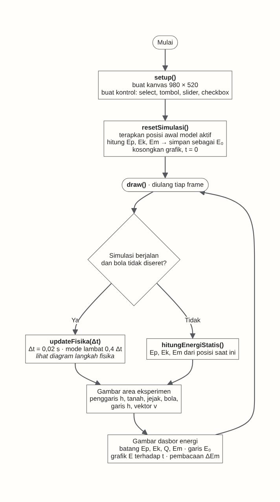
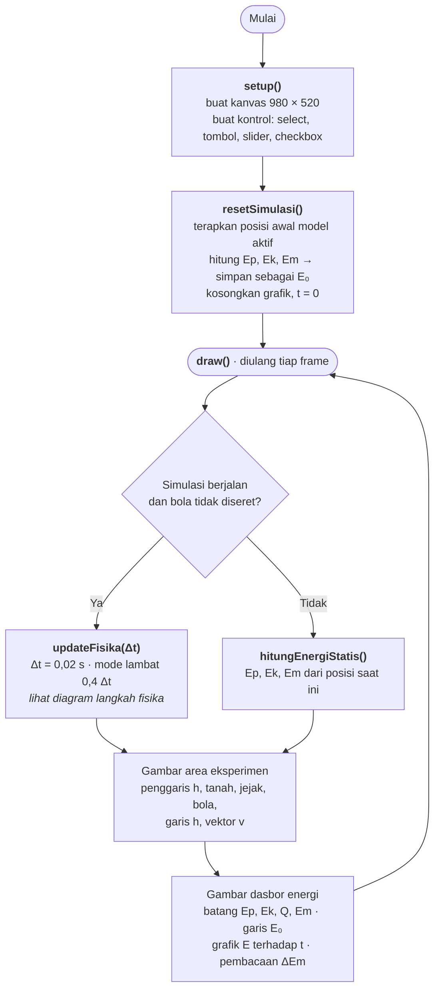
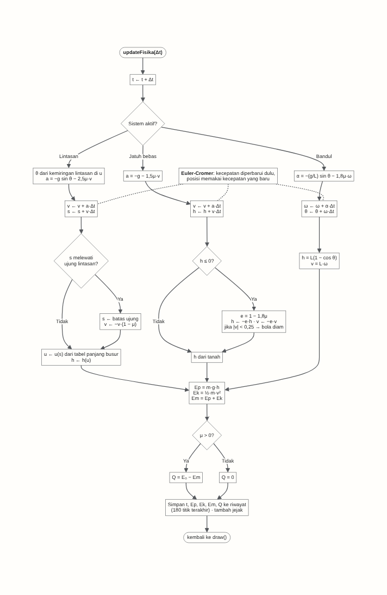
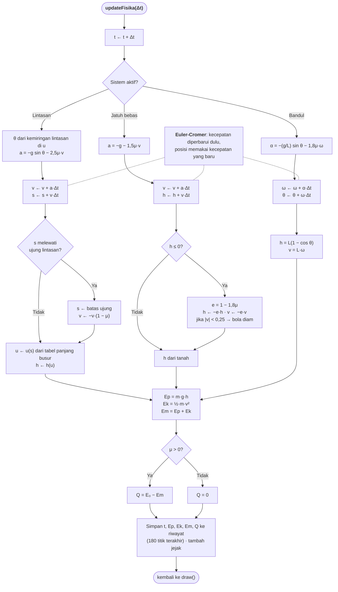
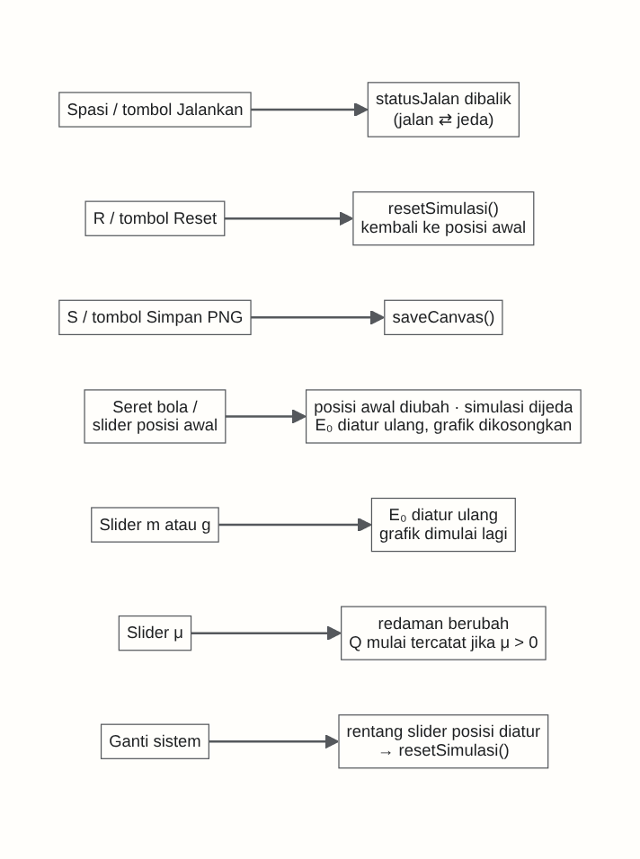
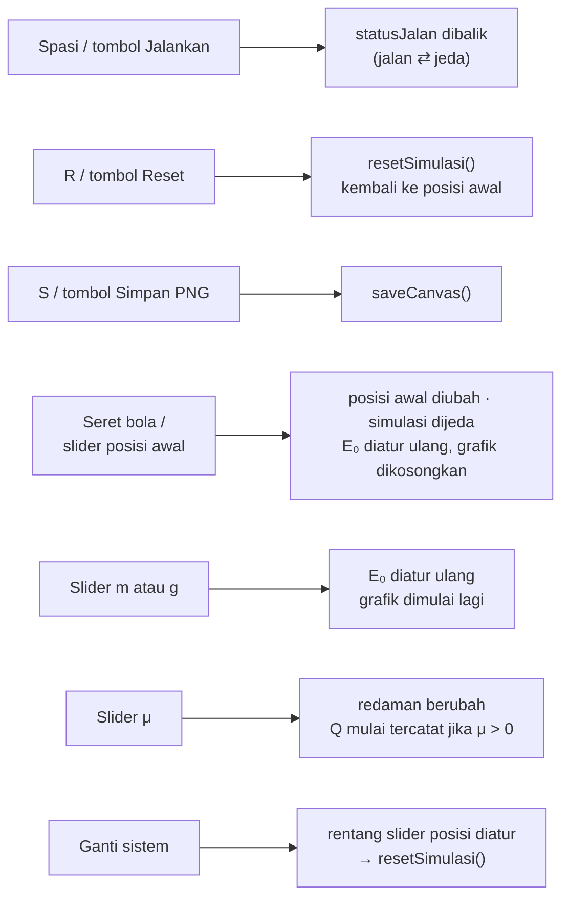

# Flowchart Simulasi Konservasi Energi Mekanik

Tiga diagram ini menggambarkan cara kerja `sketch.js`. Versi gambar untuk slide tersedia sebagai PNG dan SVG di folder ini.

## 1. Alur program

p5.js memanggil `setup()` sekali, lalu `draw()` terus-menerus, sekitar 60 kali per detik.

## 2. Satu langkah fisika: `updateFisika(Δt)`

Dipanggil sekali per frame selama simulasi berjalan. Ketiga sistem memakai urutan Euler-Cromer yang sama: kecepatan diperbarui dulu, lalu posisi memakai kecepatan yang baru.

## 3. Masukan pengguna

Kejadian ini bisa terjadi kapan saja di antara dua frame. Hasilnya terlihat pada `draw()` berikutnya.

